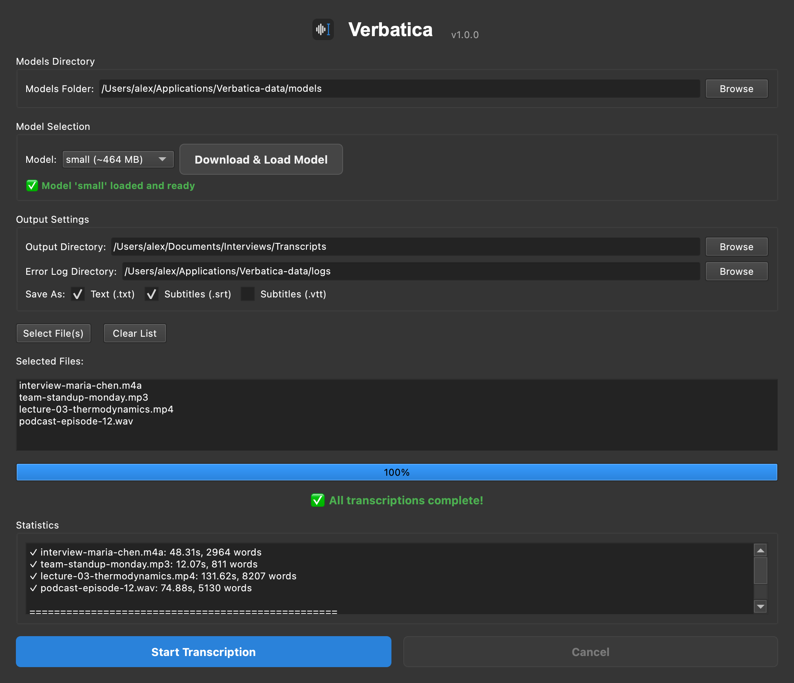

Transcribe audio and video files on your own computer with OpenAI's Whisper speech recognition models. Save the results as text or subtitles. Works offline after the first model download. Sends no audio or text anywhere.

Website: [tariqmk.github.io/Verbatica](https://tariqmk.github.io/Verbatica/)

<picture>
  <source media="(prefers-color-scheme: light)" srcset="assets/screenshots/main-window-light.png">
  
</picture>

## Features
- Transcribes MP3, M4A, WAV, FLAC, OGG, MP4, MOV, AVI and MKV files.
- Transcribes a queue of files one after another. Drag files onto the window or select **Add files**.
- Shows the waveform of each file. Written parts turn bright, and a blue cursor marks the progress. Skipped silence shows as a flat line.
- Needs no other software. Audio decoding is built in.
- Skips long silences, which saves time and prevents invented text in silent parts.
- Saves each result as text (`.txt`), SRT subtitles (`.srt`), WebVTT subtitles (`.vtt`), or any combination.
- Never overwrites an existing result. If `talk.txt` exists, the new result is saved as `talk (2).txt`.
- Downloads each model once and verifies every file against a SHA256 checksum.
- Shows progress within each file. **Stop** stops within about 30 seconds of audio.
- Opens the folder of each finished transcript with **Show in Finder** (Windows: **Show in Explorer**).
- Follows the system light or dark appearance.
- Portable: settings and models are kept in a folder next to the app.

## Download
Download the latest version from the [Releases page](https://github.com/TariqMK/Verbatica/releases):

| Platform | File |
|---|---|
| Windows (64-bit) | `Verbatica-vX.Y.Z-windows-x64.exe` |
| macOS (Apple Silicon) | `Verbatica-vX.Y.Z-macos-arm64.zip` |
| Linux (64-bit) | `Verbatica-vX.Y.Z-linux-x64.tar.gz` |

The macOS download is about 80 MB.

**Note:** The builds are not code-signed.
- macOS: the first time you open the app, macOS blocks it. Open **System Settings > Privacy & Security** and select **Open Anyway**.
- Windows: if SmartScreen shows a warning, select **More info**, then **Run anyway**.

## Set up the app
1. Put the app in a folder you can write to, for example a new folder in Documents.
   **Note:** The app creates its data folder, `Verbatica-data`, next to itself. Do not run it from a read-only folder such as `Program Files`.
   **Note (macOS):** Unzip the download and move `Verbatica.app` out of Downloads before you open it.
2. Open the app.

## How to use
1. In the **Model** menu at the top of the window, choose a model.
   **Note:** Larger models are more accurate, but slower, and need more memory. The sizes are 75 MB (tiny) to 2.9 GB (large-v3).
2. Select the button next to the menu. It shows **Download** and the size the first time, and **Load** after the model is downloaded. When the model is ready, the window shows **Loaded**.
   **Note:** If a model file is damaged, the app asks before it downloads a new copy. The damaged file is replaced only after the new download is verified. An interrupted download continues with the missing files.
3. Next to **Save to**, select **Change…** and choose where to save the results.
4. Next to **Formats**, select one or more of **Text**, **SRT** and **VTT**.
5. Drag files onto the window, or select **Add files** and choose them. The app skips files that are already in the queue.
6. Select **Transcribe** (Ctrl+Return, or Command-Return on macOS).
7. To stop, select **Stop**. The file in progress is not saved. Files that are not done stay in the queue.

Each row shows the file's state. A finished file shows its word count and a **Show in Finder** button. A failed file shows **Failed**. Hold the pointer over it to read the error. Select **Transcribe** again to run only the files that are not done.

The app names each result after its source file, for example `interview.mp3` gives `interview.txt`. Errors are written to a log in the error log folder.

To remove one file, select **×** at the end of its row. To remove all files, select **Clear**.

### Settings
Open **Settings** from the app menu (macOS: **Verbatica > Settings…**, Command-comma) or the **File** menu (Windows and Linux).

- **Models folder:** where downloaded models are kept.
- **Error logs:** where the app writes a log when a file fails.
- **Updates:** the version number and **Check for updates**.

## Check for updates
1. Select **Check for Updates…** in the app menu (macOS) or the **File** menu (Windows and Linux). You can also select **Check for updates** in **Settings**.
2. Read the result. If a newer version exists, select **Open Release Page** to download it.

The app checks only when you ask. It never checks on its own.

## Privacy
- Transcription runs fully on your computer. Audio and transcripts never leave it.
- No telemetry, analytics or tracking.
- With a model downloaded, the app works with no internet connection.
- Settings, models and error logs are stored in the `Verbatica-data` folder next to the app. Move the app and that folder together to keep everything.
- Transcripts are saved only in the folder you choose.
- The app makes only two network connections, and only when you ask:
  - When you select **Download** for a model, the app downloads its files from Hugging Face (`huggingface.co`). It sends nothing except the requests for the files.
  - When you select **Check for Updates…**, the app asks GitHub (api.github.com) for the latest release. It sends nothing else and nothing is downloaded.

## Run from source
You need Python 3.9 or later.

1. Clone this repository and open a terminal in its folder.
2. Create a virtual environment: `python3 -m venv .venv`
3. Activate it:
   - macOS and Linux: `source .venv/bin/activate`
   - Windows: `.venv\Scripts\activate`
4. Install the app and its dependencies: `pip install -e ".[dev]"`
5. Start the app: `python -m verbatica`

A source run shows the version `v0.0.0.dev0` and keeps its data in `Verbatica-data` in the project folder.

**Note:** Settings from versions before the data folder (`~/.whisper_gui_settings.json`) are copied over on first start. The old file is not changed or deleted.

**Note:** Earlier versions used OpenAI's `.pt` model files. This version uses converted models in folders named `faster-whisper-<model>`, so each model is downloaded once more. The old `.pt` files are not used, and the app does not delete them. You can delete them yourself.

## How it works
The app runs Whisper models with [faster-whisper](https://github.com/SYSTRAN/faster-whisper), which uses the CTranslate2 engine instead of PyTorch. The models are OpenAI's Whisper models, converted by SYSTRAN, and pinned to an exact version on Hugging Face. Accuracy is about the same as OpenAI's own package. The app is smaller, uses about half the memory, and needs no ffmpeg.

## Run the tests
1. Install the development dependencies (step 4 above).
2. Run: `python -m pytest`

The tests use a fake model. They do not need a model download or a network connection. One test runs the real audio decoder when faster-whisper is installed.

## Update the Screenshots
The screenshots come from the real app, filled with made-up sample data. Retake them after a change to the window.

1. Install the app from source (step 4 of **Run from source**).
2. Run: `python assets/make_screenshots.py`

The script writes four images to `assets/screenshots/`: `main-window-dark.png` and `main-window-light.png` (a queue in progress), `empty-dark.png` (first open) and `settings-dark.png`. It uses a temporary data folder, so it does not read or change your settings.

To rebuild the icon, banner and social card after a change to the icon or tagline, install Pillow (`pip install pillow`) and run `python assets/make_assets.py`.

**Note:** The website in `docs/` uses copies of the icon and social card. After you run `make_assets.py`, copy `assets/icon/verbatica.svg` to `docs/icon.svg` and `assets/social-card.png` to `docs/social-card.png`.

## Website
The website is in `docs/`. GitHub Pages serves it from the `main` branch, `/docs` folder. It is plain HTML, CSS and JavaScript with no build step.

- The download buttons get the latest release from the GitHub API. They find each file by the end of its name: `windows-x64.exe`, `macos-arm64.zip` and `linux-x64.tar.gz`.
- If the lookup fails, the buttons open the Releases page.
- Drafts and pre-releases are not shown.

To preview the website, run `python -m http.server 8765 --bind 127.0.0.1` in `docs/` and open `http://127.0.0.1:8765/`.

## Creating a Release
Releases are built by the **Release** workflow in GitHub Actions.

1. Open the **Actions** tab on GitHub and select **Release**.
2. Select **Run workflow** and choose the branch. Releases (`draft` and `public`) run only on `main`.
3. Choose the **Release type**:
   - `draft` creates a draft release that only you can see. Publish it on GitHub when it is ready.
   - `public` publishes the release immediately.
   - `test-build` builds all three platforms from any branch, without a version number, tag or release. Download the files from the **Artifacts** section of the workflow run. GitHub keeps them for 90 days.
4. Choose the **Version increment**: `patch` (1.2.3 → 1.2.4), `minor` (1.2.3 → 1.3.0) or `major` (1.2.3 → 2.0.0).
5. Select **Run workflow**.

The workflow runs the tests first. It then builds Windows, macOS and Linux versions and checks that each build can decode audio and load its speech-detection model. It creates the tag and the release only when every build succeeds.

The next version comes from the highest existing `vX.Y.Z` tag or release, including drafts. The first release is `v0.0.1` for a patch. The version is written into the app on the build machine only. The workflow never commits to any branch. No secrets need to be set up.
