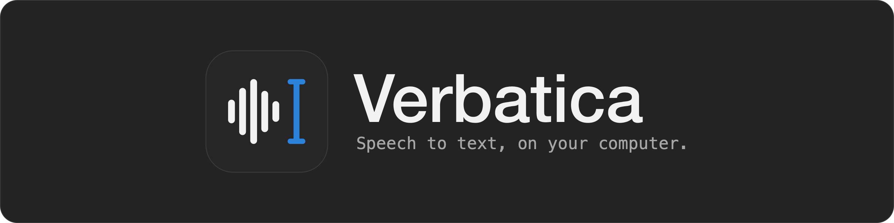
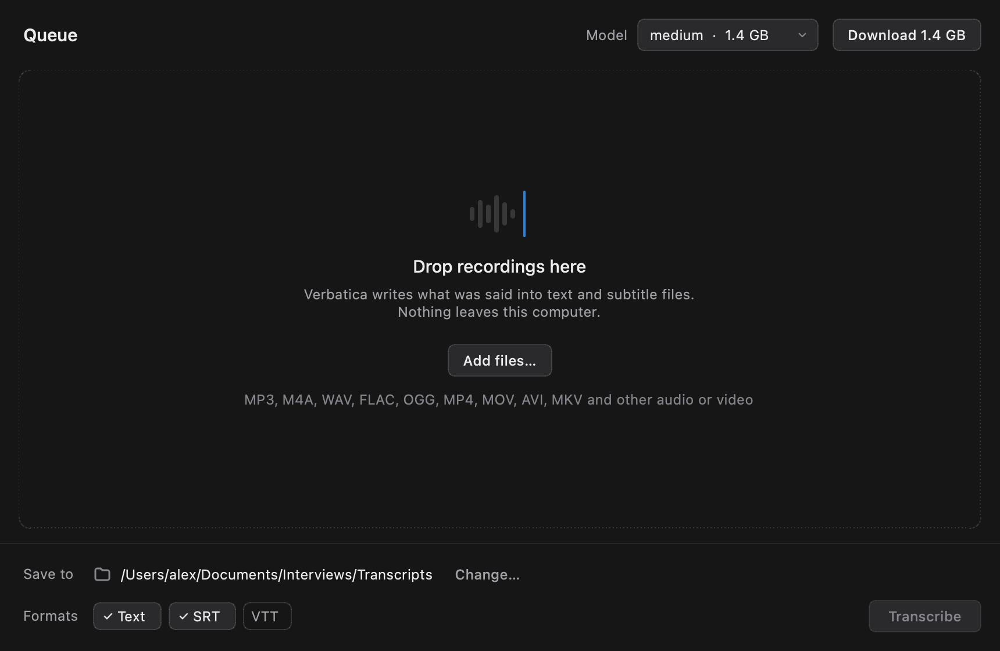
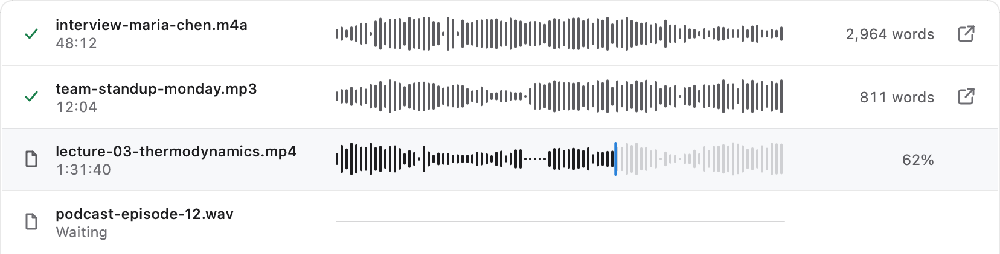
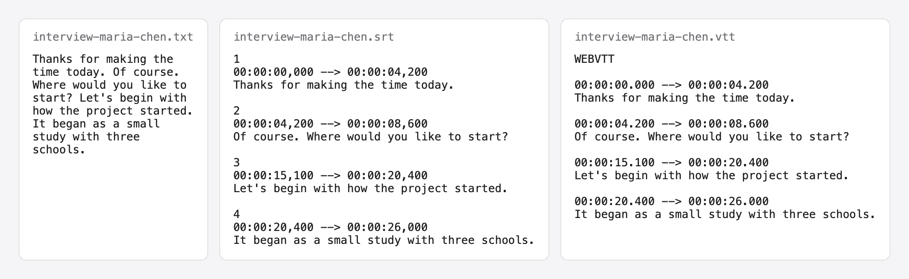
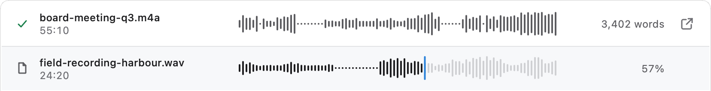
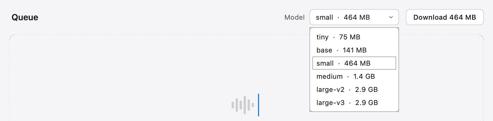
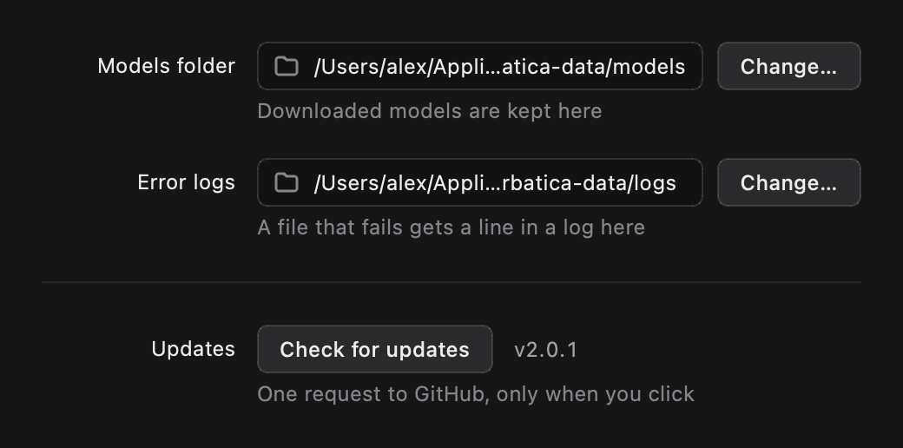

Verbatica turns your recordings into text and subtitle files on your own computer. Works offline. Sends no audio or text anywhere.

**Contents:** [What it does](#what-it-does) · [Privacy](#privacy) · [Download](#download) · [How to use](#how-to-use) · [For developers](#for-developers)

<picture>
  <source media="(prefers-color-scheme: light)" srcset="assets/screenshots/main-window-light.png">
  
</picture>

## What it does
Drop in interviews, lectures, meetings or podcasts. Verbatica writes down what was said and saves it as text or subtitles. It uses Whisper, a speech recognition model made by OpenAI, and runs it on your computer.

### A whole queue in one go

Drag a stack of recordings onto the window and select **Transcribe**. Verbatica works through them one after another. It reads MP3, M4A, WAV, FLAC, OGG, MP4, MOV, AVI and MKV files, with nothing else to install.

### Watch each file being written
<picture>
  <source media="(prefers-color-scheme: dark)" srcset="assets/screenshots/queue-dark.png">
  
</picture>

Every file shows its sound as a waveform. The parts already written turn bright, and a blue cursor marks the progress. A finished file shows its word count and a **Show in Finder** button (Windows: **Show in Explorer**).

### Text and subtitles from one run
<picture>
  <source media="(prefers-color-scheme: dark)" srcset="assets/screenshots/outputs-dark.png">
  
</picture>

Save each result as plain text (`.txt`), SRT subtitles (`.srt`), WebVTT subtitles (`.vtt`), or any combination. Each result is named after its recording. An earlier result is never overwritten: if `talk.txt` exists, the new one is saved as `talk (2).txt`.

### Skips the silence
<picture>
  <source media="(prefers-color-scheme: dark)" srcset="assets/screenshots/silence-dark.png">
  
</picture>

Long silent parts are found and skipped. This saves time and stops the model from inventing words where nobody spoke. Skipped silence shows as a flat line in the waveform.

### Pick speed or accuracy
<picture>
  <source media="(prefers-color-scheme: dark)" srcset="assets/screenshots/models-dark.png">
  
</picture>

Choose one of six models, from tiny (75 MB) to large-v3 (2.9 GB). Larger models are more accurate, but slower, and need more memory. Each model downloads once and is checked, so a broken download is never used.

### Everything in one folder

Settings, models and error logs stay in a folder next to the app. Move the app and that folder together and everything comes with it. The window follows your system's light or dark appearance.

## Privacy
- Transcription runs fully on your computer. Your recordings and transcripts never leave it.
- No accounts, no telemetry, no tracking.
- With a model downloaded, the app works with no internet connection.
- Settings, models and error logs are stored in the `Verbatica-data` folder next to the app.
- Transcripts are saved only in the folder you choose.
- The app connects to the internet only when you ask, and only for two things:
  - When you select **Download** for a model, the app downloads the model files from Hugging Face (`huggingface.co`). It sends nothing except the requests for the files.
  - When you select **Check for Updates…**, the app asks GitHub (`api.github.com`) for the latest version. It sends nothing else, and nothing is downloaded.

## Download
The app runs on Windows (64-bit), macOS on Apple Silicon and Linux (64-bit).

1. Open the [Releases page](https://github.com/TariqMK/Verbatica/releases/latest), or the [Verbatica website](https://tariqmk.github.io/Verbatica/).
2. Download the file for your computer:

   | Computer | File |
   |---|---|
   | Windows (64-bit) | `Verbatica-vX.Y.Z-windows-x64.exe` |
   | macOS (Apple Silicon) | `Verbatica-vX.Y.Z-macos-arm64.zip` |
   | Linux (64-bit) | `Verbatica-vX.Y.Z-linux-x64.tar.gz` |

3. Make a new folder for the app, for example in Documents.
   **Note:** The app creates its data folder, `Verbatica-data`, next to itself. Do not put it in a folder you cannot write to, such as `Program Files`.
4. Put the app in that folder.
   - Windows: move the `.exe` file into it.
   - macOS: unzip the download and move `Verbatica.app` into it. Do not open the app from Downloads.
   - Linux: extract the archive into it.
5. Open the app.
   **Note:** On Windows, SmartScreen can show a warning. Select **More info**, then **Run anyway**.

The macOS download is about 80 MB.

### Opening on macOS

Verbatica isn't notarised by Apple, so macOS shows a warning the first time you open it. This is expected and doesn't mean the app is harmful.

1. Open Verbatica and click **Done** on the warning.
2. Open **System Settings → Privacy & Security**, scroll down to the message saying "Verbatica" was blocked, and click **Open Anyway**.
3. Enter your password, then click **Open** on the next prompt. You only need to do this once.

If you use Terminal

You can run this instead:

    xattr -dr com.apple.quarantine "/Applications/Verbatica.app"

## How to use

### Transcribe files
1. In the **Model** menu at the top of the window, choose a model.
   **Note:** Larger models are more accurate, but slower, and need more memory. The sizes are 75 MB (tiny) to 2.9 GB (large-v3).
2. Select the button next to the menu. It shows **Download** and the size the first time, and **Load** after the model is downloaded. When the model is ready, the window shows **Loaded**.
   **Note:** If a model file is damaged, the app asks before it downloads a new copy. The damaged file is replaced only after the new copy is checked. An interrupted download continues with the missing files.
3. Next to **Save to**, select **Change…** and choose where to save the results.
4. Next to **Formats**, select one or more of **Text**, **SRT** and **VTT**.
5. Drag files onto the window, or select **Add files** and choose them. The app skips files that are already in the queue.
6. Select **Transcribe** (Ctrl+Return, or Command-Return on macOS).
7. To stop, select **Stop**. The app stops within about 30 seconds of audio. The file in progress is not saved. Files that are not done stay in the queue.

Each row shows the state of its file. A finished file shows its word count and a **Show in Finder** button. A failed file shows **Failed**. Hold the pointer over it to read the error. The error is also written to a log in the error logs folder.

To try again, select **Transcribe**. The app runs only the files that are not done.

The app names each result after its source file. For example, `interview.mp3` gives `interview.txt`.

### Remove files from the queue
**Note:** Removing a file from the queue does not delete its transcript. You cannot remove files while **Transcribe** runs.

- To remove one file, select **×** at the end of its row.
- A finished file has no **×**. Right-click its row and select **Remove from Queue**.
- To remove all finished files, select **Queue > Remove Finished Files**.
- To remove all files, select **Clear**.

### Settings
Open **Settings** from the app menu (macOS: **Verbatica > Settings…**, Command-comma) or the **File** menu (Windows and Linux).

- **Models folder:** where downloaded models are kept.
- **Error logs:** where the app writes a log when a file fails.
- **Updates:** the version number and **Check for updates**.

### Check for updates
1. Select **Check for Updates…** in the app menu (macOS) or the **File** menu (Windows and Linux). You can also select **Check for updates** in **Settings**.
2. Read the result. If a newer version exists, select **Open Release Page** to download it.

The app checks only when you ask. It never checks on its own.

## For developers

Building the app yourself or changing it? Everything you need is below.

<strong>Run from source</strong>

You need Python 3.9 or later.

1. Clone this repository and open a terminal in its folder.
2. Create a virtual environment: `python3 -m venv .venv`
3. Activate it:
   - macOS and Linux: `source .venv/bin/activate`
   - Windows: `.venv\Scripts\activate`
4. Install the app and its dependencies: `pip install -e ".[dev]"`
5. Start the app: `python -m verbatica`

A source run shows the version `v0.0.0.dev0` and keeps its data in `Verbatica-data` in the project folder.

**Note:** Settings from versions before the data folder (`~/.whisper_gui_settings.json`) are copied over on first start. The old file is not changed or deleted. An `Audio-Transcriber-data` folder from versions before the rename is renamed to `Verbatica-data` on start.

**Note:** Earlier versions used OpenAI's `.pt` model files. This version uses converted models in folders named `faster-whisper-<model>`, so each model is downloaded once more. The old `.pt` files are not used, and the app does not delete them. You can delete them yourself.

<strong>Run the tests</strong>

1. Install the development dependencies (step 4 of **Run from source**).
2. Run: `python -m pytest`

The tests use a fake model. They do not need a model download or a network connection. One test runs the real audio decoder when faster-whisper is installed.

<strong>How it works</strong>

The app runs Whisper models with [faster-whisper](https://github.com/SYSTRAN/faster-whisper), which uses the CTranslate2 engine instead of PyTorch. The models are OpenAI's Whisper models, converted by SYSTRAN, and pinned to an exact version on Hugging Face. Accuracy is about the same as OpenAI's own package. The app is smaller, uses about half the memory, and needs no ffmpeg. Audio decoding is built in.

- Each model file is downloaded to a `.part` file, checked against its SHA256 checksum, and only then given its real name.
- Each recording is decoded once. The same audio draws the waveform and goes to the model.
- Silence is found with a voice activity detection model (Silero VAD) and skipped.

<strong>Update the screenshots</strong>

The screenshots come from the real app, filled with made-up sample data. Retake them after a change to the window.

1. Install the app from source (step 4 of **Run from source**).
2. Run: `python assets/make_screenshots.py`

The script writes these images to `assets/screenshots/`:

- `main-window-dark.png` and `main-window-light.png`: a queue in progress.
- `queue-*.png`, `silence-*.png`, `outputs-*.png` and `models-*.png`: one picture per feature in **What it does**, in dark and light.
- `empty-dark.png`: the window on first open.
- `settings-dark.png`: the Settings window.

The `outputs` image is drawn by the script from a made-up transcript, using the app's own Text, SRT and VTT writers. It uses a temporary data folder, so it does not read or change your settings.

To rebuild the icon, banner and social card after a change to the icon or tagline, install Pillow (`pip install pillow`) and run `python assets/make_assets.py`.

**Note:** The website in `docs/` uses copies of the icon and social card. After you run `make_assets.py`, copy `assets/icon/verbatica.svg` to `docs/icon.svg` and `assets/social-card.png` to `docs/social-card.png`.

<strong>Website</strong>

The website is in `docs/`. GitHub Pages serves it from the `main` branch, `/docs` folder. It is plain HTML, CSS and JavaScript with no build step.

- The download buttons get the latest release from the GitHub API. They find each file by the end of its name: `windows-x64.exe`, `macos-arm64.zip` and `linux-x64.tar.gz`.
- If the lookup fails, the buttons open the Releases page.
- Drafts and pre-releases are not shown.

To preview the website, run `python -m http.server 8765 --bind 127.0.0.1` in `docs/` and open `http://127.0.0.1:8765/`.

<strong>Creating a Release</strong>

Releases are built by the **Release** workflow in GitHub Actions.

1. Open the **Actions** tab on GitHub and select **Release**.
2. Select **Run workflow** and choose the branch. Releases (`draft` and `public`) run only on `main`.
3. Choose the **Release type**:
   - `draft` creates a draft release that only you can see. Publish it on GitHub when it is ready.
   - `public` publishes the release immediately.
   - `test-build` builds all three platforms from any branch, without a version number, tag or release. Download the files from the **Artifacts** section of the workflow run. GitHub keeps them for 90 days.
4. Choose the **Version increment**: `patch` (1.2.3 → 1.2.4), `minor` (1.2.3 → 1.3.0) or `major` (1.2.3 → 2.0.0).
5. Select **Run workflow**.

The workflow runs the tests first. It then builds Windows, macOS and Linux versions and checks that each build can decode audio and load its speech-detection model. It creates the tag and the release only when every build succeeds.

The next version comes from the highest existing `vX.Y.Z` tag or release, including drafts. The first release is `v0.0.1` for a patch. The version is written into the app on the build machine only. The workflow never commits to any branch. No secrets need to be set up.

**Note:** The builds are not code-signed. Windows SmartScreen and macOS show a warning the first time the app opens (see **Opening on macOS** under **Download**).

